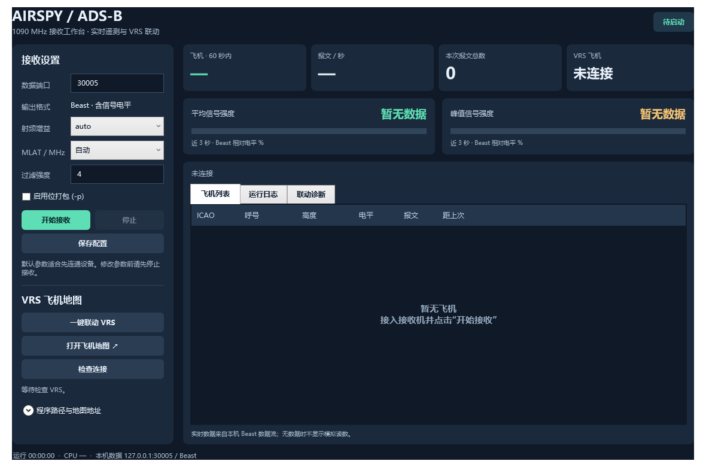

# AirspyPanel

Airspy ADS-B SPY 的中文 Windows 控制面板：启动接收、查看飞机与信号电平，并连接 Virtual Radar Server（VRS）显示地图。

[下载 Windows 版](https://github.com/PriscillaOvO/AirspyPanel/releases/latest) · [使用说明](docs/使用说明.md) · [验证说明](docs/验证说明.md)



*截图为未连接设备时的离屏界面渲染，不包含模拟飞机或个人接收数据。*

## 功能

- WPF 自适应窗口布局、左侧滚动设置区和每显示器 DPI 支持。
- 启停 ADS-B SPY，设置增益、采样模式、数据端口和过滤强度。
- 直接读取本机 Beast 数据，显示飞机列表、报文速率、累计报文数。
- 显示平均、峰值两个相对信号电平条。
- 一键备份并配置 VRS 接收机，检查网页数据来源，打开飞机地图。
- 自选解码器和 VRS 安装位置，导出运行日志。

## 系统要求与依赖

- Windows 桌面系统及 **.NET Framework 4.8 或更新的 4.x 运行环境**。当前发布构建在 Windows 11 x64 验证，其他系统尚未实测。
- Airspy R0 / R2 / Mini、可用的设备驱动及 1090 MHz 天线。
- 从 [Airspy 官方下载页](https://airspy.com/download/) 下载 **ADS-B SPY – ADSB decoder for Windows**，完整解压，保留其 DLL。
- 地图联动需要另行安装 [Virtual Radar Server](https://www.virtualradarserver.co.uk/Download.aspx)。VRS 的运行环境要求独立于本面板；旧版 VRS 可能要求启用 .NET Framework 3.5。

本项目是独立控制面板，与 Airspy 和 VRS 官方无隶属关系。发布包不包含解码器、驱动、第三方 DLL 或 VRS。

## 快速开始

1. 从 Releases 下载 `AirspyPanel-v2.0.0-windows.zip`，完整解压到当前用户可写的文件夹。
2. 双击 `AirspyPanel.exe`，通过左侧路径设置选择 `airspy_adsb.exe`。若解码器就在面板旁边，会直接使用该目录。
3. 接好设备与天线，关闭其他占用接收机的软件。默认端口 **30005**、增益 `auto`、过滤强度 `4`，点击“开始接收”。
4. 需要地图时，选择 `VirtualRadar.exe`，填写与 VRS 主界面一致的地图地址，再点击“一键联动 VRS”。
5. 等 VRS 网页连接成功后，点击“打开飞机地图”。

联动会创建或更新名为 `Airspy Panel` 的接收机，使用 `127.0.0.1`、面板端口与 **Beast** 格式，并将其设为网页默认接收机。原配置会先备份；如果 VRS 正在运行，面板会询问是否正常关闭并重启。

## 数据含义

| 指标 | 统计方式 |
| --- | --- |
| 面板飞机数 | 最近 60 秒收到的 DF11 / DF17 报文中的显式 ICAO 地址去重；超时移出列表 |
| 平均 / 峰值电平 | 最近 3 秒 Beast 报文的电平字节（0–255）转换为 0–100%，计算平均值与最大值 |
| 报文速率 | 最近约 3 秒内收到的 Beast 报文数除以窗口时长；启动初期按实际时长（最少 1 秒）计算 |
| 累计报文 | 本次接收累计的 Beast 报文数 |
| VRS 飞机 | VRS 数据接口返回的跟踪数，与本面板的解析范围和超时规则可能不同 |

电平来自解码器的 `-R rms` 模式，**不是校准后的 dBm、噪声底或频谱扫描强度**。最近 3 秒没有报文时显示“暂无数据”。呼号和气压高度只在收到对应、可解析的报文后出现；位置解码与地图由 VRS 提供。

## 从源码构建

在 Windows PowerShell 中进入仓库目录：

```powershell
powershell -NoProfile -ExecutionPolicy Bypass -File .\build.ps1
```

脚本使用 Windows 的 .NET Framework C# 编译器与 WPF 程序集，不需要 NuGet 包。输出为 `bin/AirspyPanel.exe` 及配置文件。`-OutputDirectory` 可指定输出位置，构建路径不依赖特定盘符或用户名。

运行自测和布局渲染：

```powershell
$p = Start-Process .\bin\AirspyPanel.exe -ArgumentList '--self-test' -Wait -PassThru
if ($p.ExitCode -ne 0) { throw 'Self-test failed; see bin/self-test.txt' }
$p = Start-Process .\bin\AirspyPanel.exe -ArgumentList '--render' -Wait -PassThru
if ($p.ExitCode -ne 0) { throw 'Layout test failed; see bin/layout-test.txt' }
```

测试使用独立的临时本机 TCP 端口和测试 XML，不写入实际 VRS 配置，不发送数据到实际 VRS。测试报告及渲染图片生成在输出目录。

## 许可

自制面板源码及文档采用 [MIT License](LICENSE)，允许修改、再分发和商用并保留许可声明。Airspy、ADS-B SPY、VRS 及其他第三方组件的名称、程序与许可分别归其权利人所有，MIT 不适用于这些外部组件。
