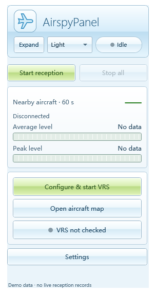
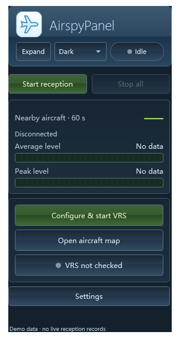
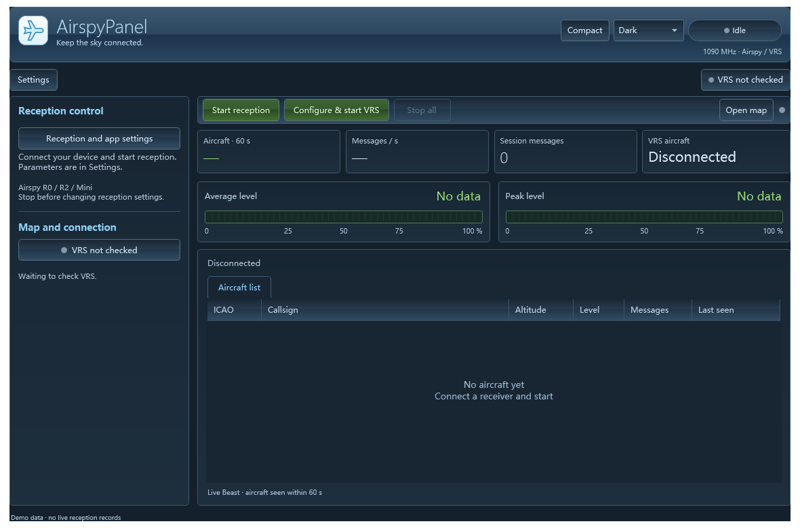
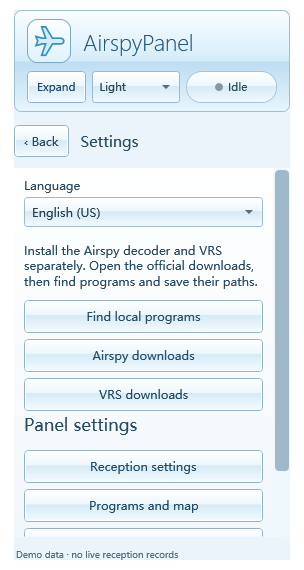
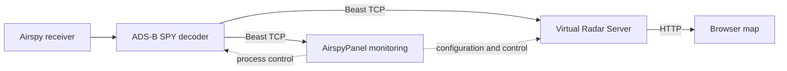

# AirspyPanel

[English](docs/guide/en-US.md) · [简体中文](docs/guide/zh-CN.md) · [日本語](docs/guide/ja-JP.md) · [Français](docs/guide/fr-FR.md) · [Deutsch](docs/guide/de-DE.md) · [Русский](docs/guide/ru-RU.md)

A Windows control panel for Airspy ADS-B reception and Virtual Radar Server, with an MSN 2009 / Aero-inspired interface.

**[Download v3.0.0](https://github.com/PriscillaOvO/AirspyPanel/releases/tag/v3.0.0)** · [User guide](docs/guide/en-US.md) · [Verification](docs/verification.md) · [Report a bug](https://github.com/PriscillaOvO/AirspyPanel/issues)


## Features

- Airspy ADS-B SPY process control and real Beast aircraft counts, average and peak relative signal levels.
- VRS configuration backups, launch and structured API/source/configuration status.
- Resizable full view and fixed compact panel; settings, logs and details remain inside either window.
- Light/dark/system themes, system tray, single-instance restore and six instantly switchable languages.
- Bounded local program discovery, per-user settings, filtered key events and separate raw output.

| Compact | Dark compact |
| --- | --- |
|  |  |

<details><summary>Dark full view and settings</summary>




</details>

Screenshots use preview instances without live reception records or personal configuration.

## Install

Requires Windows 10/11 and .NET Framework 4.8. Development tests run on Windows 11 x64; see the verification record for untested environments and hardware limitations.

1. Download `AirspyPanel-v3.0.0-setup.exe` or extract `AirspyPanel-v3.0.0-portable.zip`. Compare SHA-256 with `SHA256SUMS.txt` using PowerShell `Get-FileHash`.
2. Obtain [ADS-B SPY for Windows](https://airspy.com/download/) and [Virtual Radar Server](https://www.virtualradarserver.co.uk/Download.aspx) separately. Keep decoder DLLs. VRS may also require Windows .NET Framework 3.5.
3. In Settings, find local programs, choose candidates and save paths.
4. Connect Airspy R0/R2/Mini and a 1090 MHz antenna. Start reception, configure/start VRS, then open the map.

The release is unsigned. Keep Windows security protections enabled. No drivers or third-party executables are bundled; no startup-at-login or silent dependency installation is added.

Setup installs for the current user. Upgrades preserve `%LOCALAPPDATA%\AirspyPanel` settings. Exit the panel before installing. Uninstall keeps settings unless you explicitly choose deletion. The ZIP edition uses the same settings directory, not an isolated portable profile.

## Operation

**Stop all** and **Exit application** stop the panel-owned decoder and normally close local VRS, including manually launched VRS. Browser map tabs stay open. If VRS cannot close, the failure is reported; exiting offers retry, cancel or explicitly leaving VRS running. Minimizing to the tray keeps reception running.

Green VRS status means API, source and configuration match. Yellow means data is available but source/configuration needs review. Zero aircraft can be normal. Click the indicator for details. Local configuration mismatch does not block opening the map.

Mean and peak levels use three seconds of Beast messages, mapping 0–255 to 0–100%. They are **not calibrated dBm, spectrum or noise-floor measurements**. Counts use unique explicit DF11/17 ICAO addresses within 60 seconds; VRS has its own rules. Sampling mode is not the 1090 MHz receive frequency and does not provide standalone MLAT.

## How it works



The panel controls and observes existing software; it does not replace the decoder or map server. No telemetry or automatic update service is added.

## Build and contribute

```powershell
.\build.ps1
Start-Process .\bin\AirspyPanel.exe -ArgumentList '--self-test' -Wait
```

Output is in `bin`. VS Code includes build/run/test tasks. [CONTRIBUTING.md](CONTRIBUTING.md) covers rendering, Inno Setup and packaging. [Architecture](docs/architecture.md) describes backend interfaces, localization and migrations. `VERSION` is the single release version source.

Six translated guides cover installation, operation, VRS, troubleshooting, building and licensing. Native-speaker corrections are welcome; translations are not linguistically certified.

## License

Self-authored code, artwork and documentation are [MIT licensed](LICENSE). AirspyPanel is not affiliated with Airspy or VRS. Third-party names and software retain their owners' rights; a download link is not assumed to authorize redistribution. See [third-party notices](THIRD-PARTY-NOTICES.md).
